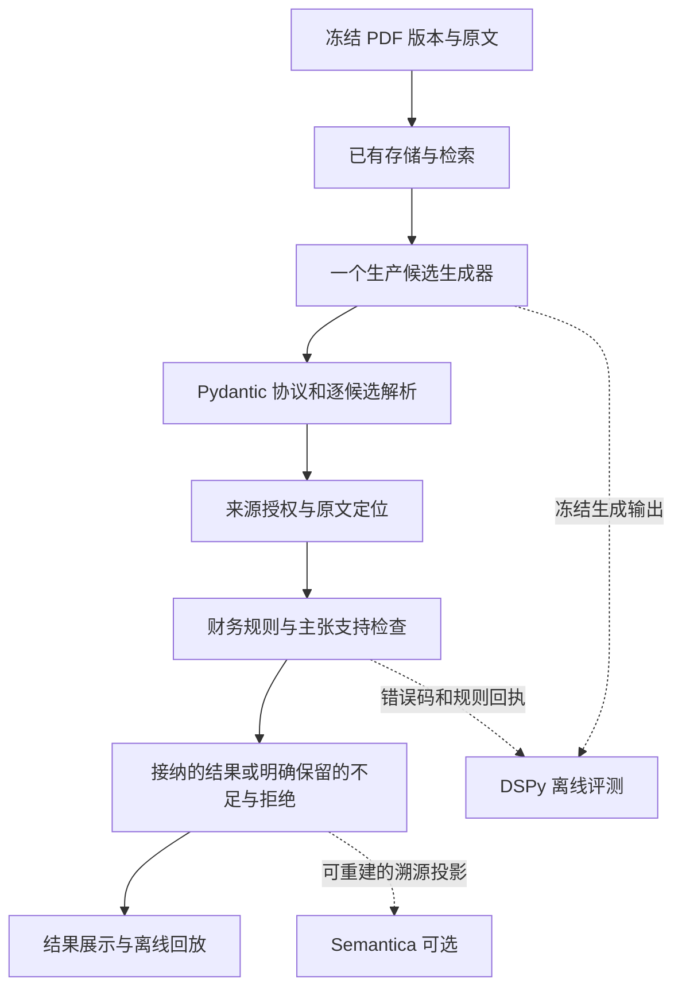

# FinReport 开源组件职责冲突与金融语义能力分析

> 本文保留组件取舍时的历史代码快照；下文“当前”“尚未”等表述均以该次审查为准。随后已补齐通用保守准入、DSPy v2字段合同及只读证据视图，不将旧缺口描述误作最新实现状态。最新行为、实验结果与仍存限制分别见[语义准入修复记录](semantic-remediation-validation-20261019.md)和[结构化候选核查](grounded-analysis-validation-20261019.md)。

核查日期：2026-10-19。对象：当前工作区代码、冻结历史输出、TODO 及官方文档。当前 Git 基点为 `0cd2bee6ed89ee1bfea9cb8e8ad2948869688215`，工作区含尚未提交的扩展接入及其他改动；本文描述工作区实际实现，不将这些实现全部归入该提交。

本文是分析与取舍建议。本次不修改生产代码、不删除依赖、不实施新框架迁移、不提交 Git；不调用外部 LLM。此前扩展安装和软件测试记录见 [开源扩展接入说明](D:/code/FinReport/docs/open-source-analysis-extensions.md)，本文不会把那些软件测试数量解释为金融语义准确率。

## 一、结论与需要纠正的前提

**这些项目可以共同组成系统，但不应全部成为正式运行的必经环节。对当前语义问题，最优先的工作是补齐已有规则的入口接线、逐条主张与证据的绑定、以及能够检查解释正文的评测。继续堆叠框架不能替代这些工作。**

需要纠正三个前提：

1. **“要求每条预测有依据和引用，就能保证语义正确”不成立。** 历史错误已经附带正确原文，错在模型对原文的解释。必须检查原文是否支持具体主张，而不只是检查引用是否存在。
2. **“Guardrails AI 已安装，所以已阻止金融语义错误”不成立。** 当前仅接入协议外壳检查，没有注册金融自定义验证器；框架不会自行获得本项目的会计规则。
3. **“Semantica 接入后已经有可查询的企业—资产关系图”不符合当前实现。** 当前图只记录财报、来源、候选之间的溯源关系，没有抽取“非金融企业—持有—金融资产”这类业务关系。

### 1.1 建议保留什么

| 组件 | 当前实际接入 | 建议 | 判断理由 |
|---|---|---|---|
| Pydantic | 主分析链已有强类型模型、枚举、长度、额外字段约束；部分跨字段金融规则仍在业务函数 | **必须保留，作为唯一协议模型来源** | 已接入候选解析；可统一生成 Schema。不能为了引入其他库再维护一份同义模型 |
| 既有来源授权与财务业务门禁 | 核对来源、金额、期间、计算及候选准入；含有限语义守卫 | **必须保留，优先补齐接线** | 这才是项目判定候选能否接纳的业务权威，其他 SDK 的成功不能替代它 |
| DSPy | 真实 SDK 对冻结预测进行离线评测；尚无生成 Signature、提示优化或训练 | **重点保留并推进语义评测；再决定是否优化生成** | 适合定义可测的分阶段任务，但收益来自正确的任务和指标，不来自安装本身 |
| Semantica | 可选来源溯源侧车图，默认关闭 | **保留可选，暂不扩大为第二套抽取、检索和事实库** | 可提供来源遍历与图投影；当前只有简单引用链，尚无语义改进证据 |
| Guardrails AI | 可选、默认关闭的 action envelope 协议检查 | **收缩为可选适配；无独立收益前不设为必经门槛** | 与 Pydantic 明显重叠；只有增加独立验证器能力、且不复制规则时才有必要提升地位 |
| Outlines | 可选远程 `response_format` 参数构造器；默认 native | **保留可选，默认沿用 native 适配** | 当前与原生 JSON Schema 参数构造重叠；未来多后端或本地模型需求可能增加价值 |
| OntoGPT | 未加入依赖、未接入 | **暂缓** | 需先有财务本体、中文概念映射和独立评测集；它不能与 DSPy 简单互相替代 |
| Prefect | 未安装、未接入；项目已有子命题任务状态、检查点和恢复逻辑 | **暂缓替换，维持一个调度器** | 解决执行与重试管理，不解决语义；引入前需证明现有调度能力的具体缺口 |

取舍依据是职责适配、运行稳定性、可核查收益及维护边界，不以轻量化为首要标准。本文未对七个项目进行同负载可用性或故障恢复基准，因此不把上述取舍包装为通用稳定性排名。

## 二、原始错误的逐阶段归因

### 2.1 输入与错误输出

历史 B 次运行第三轮、第三条候选（零基索引 `findings[2]`，历史记录称 `candidate2`），保存为 `finding-ddbcc525391be5c8806f180b`。原始文件是 [provider-03.json](D:/code/FinReport/tmp/gateway-completeness-20261017/h1-verified-b/provider-03.json)。该文件包含完整请求上下文，本文只摘录定位问题所需片段。

原文项目名称：

> 除同公司正常经营业务相关的有效套期保值业务外，非金融企业持有金融资产和金融负债 产生的公允价值变动损益以及处置金融资产和金融负债产生的损益

原始模型 `reason`：

> 除同公司正常经营业务相关的有效套期保值业务外，非金融企业持有金融资产和金融负债 产生的公允价值变动损益以及处置金融资产和金融负债产生的损益为非金融资产类构成行，说明栏标注无，金融资产明细与计价依据需另查附注。

其中“非金融企业”限定持有主体，资产及负债仍为“金融资产和金融负债”。模型把主体修饰语迁移到了对象分类，错误称为“非金融资产类”。该行对应金额 **825,166,000 元**；历史核查确认精确引文和金额正确。

### 2.2 哪一阶段出了问题

| 阶段 | 已有可检查证据 | 本案例的归因 |
|---|---|---|
| PDF/文字提取 | 保存的项目名称及完整引文保留“非金融企业持有金融资产和金融负债” | 未发现本错误来自提取阶段；不能据此推定整份 PDF 提取均正确 |
| 数值处理 | 对应金额为 825,166,000 元，历史核查金额一致 | 不是金额计算错误 |
| 提交给模型的证据 | 原始请求和输出可以定位该项目，模型还复述了完整原文 | 不能归因为模型完全没收到这段原文 |
| 模型解释生成 | 原始供应商 `raw_content` 的 `reason` 已出现“非金融资产类” | **错误在原始模型解释中已产生**，并非后续网页或报告改写造成 |
| 当时的候选准入 | 该候选 accepted 后保存为 finding | **当时已执行的检查未识别这条解释错误**；正确引用未能保障语义正确 |
| 当前有限守卫 | 已有主体/对象错置规则，扫描 `statement`、`rationale` 和逐项 `reason` | 可拦截已登记措辞；其执行受入口策略影响，且不是通用语义理解 |
| 当前 DSPy 评分 | 只比较分类码、数字、来源 ID 和接纳状态 | 没有评测这段 `reason` 的语义，不能用同分证明已修复 |

历史逐项归因见 [独立语义核查](D:/code/FinReport/tmp/gateway-completeness-20261017/independent-validation.md:17)。这是一个局部、明确的错误样例，不是对整份财报全部错误的统计。

## 三、结构正确、来源正确与语义正确是三件事

| 检查层 | 能回答什么 | 不能据此推出什么 |
|---|---|---|
| JSON/强类型/枚举 | 字段齐全、类型正确、枚举合法 | 字符串中的会计解释正确 |
| 原文定位与来源授权 | 引文存在、哈希一致、原文确实向模型提供过 | 模型对该引文的理解正确 |
| 本体与关系类型 | 主体、谓词、对象符合已定义类型和关系约束 | 这条关系被当前原文支持 |
| 主张与证据支持关系 | 指定原文是否支持主体、对象、否定、条件、期间、口径等具体断言 | 任意复杂会计事实和因果判断均已解决 |
| 财务业务校验 | 对已实现规则，金额、公式、口径及限定是否符合要求 | 规则集未覆盖的中文改写也正确 |

例如，把“非金融企业持有金融资产”改成“金融企业持有金融资产”，两句话都可能满足“企业—持有—资产”的合法类型。错误在主体修饰语被改写，单靠类型、本体 ID 或关系边存在不能识别。

同样，原文“未发生重大会计政策变更”不能支持“发生重大会计政策变更”；现金流调节表中的会计桥接项也不自动证明业务变化原因。必须保留否定、条件和推断层次。

## 四、职责冲突：哪些是真重叠，如何划界

| 组件组合 | 重叠或冲突的位置 | 保留与划界建议 |
|---|---|---|
| Pydantic ↔ Guardrails | 当前都检查同一个 action envelope 的结构合法性 | Pydantic 为唯一模型与 Schema 来源；Guardrails 仅做可选回执或独立能力扩展，不另写一套同义 Schema |
| Pydantic/业务规则 ↔ Guardrails 自定义验证器 | 如果在两处复制金融规则，会产生版本和结果分歧 | 金融规则保留一个实现；Guardrails 如接入，只调用同一规则接口，返回同一错误码和规则版本 |
| native JSON Schema ↔ Outlines | 当前都构造发给远程模型的结构输出参数 | 在传输适配层二选一；不要为同一次生成发起两份请求，也不要把参数构造说成本地约束解码 |
| Semantica `semantic_extract` ↔ OntoGPT ↔ DSPy 生成程序 | 若同时用于同一财报句子的关系抽取，可能产生三份候选和三次模型调用 | 对同一任务只设一个生产抽取器；其他路径先做离线对照。DSPy 可以包装并评估被选中的抽取器，无需另开并行生产链 |
| Semantica 来源图 ↔ SQLite/来源注册表 | 重复保存来源元数据，若各自写“事实”会出现权威冲突 | SQLite 保持既有持久化权威；来源注册表负责冻结来源及模型可见性授权；图只消费这些记录并形成可重建投影 |
| Prefect ↔ 现有调度器 | 重试、超时、缓存、检查点和任务状态存在重叠 | 只保留一个执行与重试权威。确需迁移时明确替换边界，不在现有循环外再包一套无边界重试 |
| 多套自动修复/重试 | Guardrails reask、模型客户端重试、业务重试或 Prefect 重试叠加 | 统一预算和错误分类；协议修复、瞬时传输重试、业务补证分开计数。不可静默修改历史输出 |

其中 Semantica 与 OntoGPT 不是天然冲突：一个可负责关系管理，一个负责按本体抽取。冲突发生在两者都被开启为同一任务的抽取器时。Guardrails 与 Pydantic 也可以互补，但当前接入尚未体现足以让两者都成为必经环节的独立能力。

### 4.1 现有实现中的关键边界

- [Pydantic finding 模型](D:/code/FinReport/packages/finance-adapters/src/finance_adapters/providers/analysis_agent.py:326)已限制枚举与字段。[action 外壳](D:/code/FinReport/packages/finance-adapters/src/finance_adapters/providers/analysis_agent.py:437)故意使用 `findings: list[object]`，随后逐条验证，避免一条坏候选拒绝整批。这是故障隔离设计，不应为了更严格的表面 Schema 把它取消。
- [Guardrails 适配](D:/code/FinReport/packages/finance-adapters/src/finance_adapters/providers/output_guard.py:139)执行本地协议检查，未注册金融自定义 validator。它不采用 SDK 自动修改后的值，且 `num_reasks=0`、`llm_api=None`，当前不会自行再请求 LLM 修复。
- [Outlines 适配](D:/code/FinReport/packages/finance-adapters/src/finance_adapters/providers/output_guard.py:186)构造远程结构参数；[模型客户端](D:/code/FinReport/packages/finance-adapters/src/finance_adapters/providers/model_clients.py:546)优先走原生 tool 分支，只有相应 response-schema 分支才选择 Outlines/native。当前没有在本机执行 token 级约束解码。
- [Semantica 图](D:/code/FinReport/packages/finance-adapters/src/finance_adapters/providers/semantic_graph.py:118)明确保存 `semantic_validation_performed=False`；[引用边](D:/code/FinReport/packages/finance-adapters/src/finance_adapters/providers/semantic_graph.py:204)明确保存 `semantic_support_verified=False`。`ready` 表示构图完成，不表示候选受原文支持。
- 图每次使用独立内存存储，最终 JSON 进入既有 trace，没有新增另一个持久化图数据库。[主链接线](D:/code/FinReport/packages/finance-adapters/src/finance_adapters/providers/analysis_agent.py:3662)明确其不参与准入、计算、模型提示或财务结果哈希。
- [来源注册表](D:/code/FinReport/packages/finance-adapters/src/finance_adapters/providers/source_registry.py:193)除了来源信息，还校验同哈希原文是否确实发给模型。它是冻结字典注册表，不是另一张 SQLite 表；Semantica 图不能替代这项授权职责。

## 五、当前仍有的四个实质缺口

### 5.1 有限语义规则没有覆盖所有分析入口

[候选语义门禁](D:/code/FinReport/packages/finance-adapters/src/finance_adapters/providers/analysis_agent.py:1428)仅在 `coverage_policy == OBLIGATION_TASK_POLICY_V1`，即 `evidence_obligation_tasks_v1` 时调用 `semantic_issues`。

[工作流默认值](D:/code/FinReport/packages/finance-adapters/src/finance_adapters/providers/analysis_agent.py:3418)仍为 `OBLIGATION_COVERAGE_POLICY_V3`。普通 [llm_analysis 调用](D:/code/FinReport/packages/finance-adapters/src/finance_adapters/providers/llm_analysis.py:751)未传该策略；[report_analysis 路径](D:/code/FinReport/packages/finance-adapters/src/finance_adapters/providers/report_analysis.py:153)则显式传入 tasks_v1。

因此，**目前只能说 tasks_v1 路径会调用这组有限语义规则，不能说所有入口都拦截了历史主体/对象错误。** 普通最终输出另有符号、因果断言等 [文本检查](D:/code/FinReport/packages/finance-adapters/src/finance_adapters/providers/llm_analysis.py:483)，但那不是对证据工作流每条 `reason` 调用本组主体/对象规则，不能拿它填补这一接线差异。

优先建议：对所有新运行明确选择并记录门禁版本，统一必要的候选检查；历史回放仍按历史版本验证，避免新规则悄悄改变旧结果和哈希。修复必须覆盖两个真实入口，而不只是直接调用规则函数。

### 5.2 DSPy 评测看不到解释语义

[标签模型](D:/code/FinReport/packages/finance-adapters/src/finance_adapters/providers/analysis_evaluation.py:44)和[冻结预测模型](D:/code/FinReport/packages/finance-adapters/src/finance_adapters/providers/analysis_evaluation.py:90)没有 `statement`、`rationale`、逐条 `reason`、规则应用或 span 支持关系字段。

[评分](D:/code/FinReport/packages/finance-adapters/src/finance_adapters/providers/analysis_evaluation.py:128)比较分类码、数值与单位/期间/口径、来源集合及接纳状态。[DSPy Module](D:/code/FinReport/packages/finance-adapters/src/finance_adapters/providers/analysis_evaluation.py:250)按 case_id 返回保存预测，没有生成 Signature，也没有提示训练。

所以，两段解释如果只差“金融资产”与“非金融资产”，但这些投影字段相同，当前评测无法区分。既有八项回归一致只能证明该投影与历史参考一致，不能证明自由解释语义正确。

优先建议：保留 V1 历史回归，另建版本化语义评测协议，不修改旧标签来冒充旧测试已经验证过语义。

### 5.3 关系图中尚无财务关系语义

当前图节点是 filing/source/candidate，边是 `extracted_from` 和 `cites`。没有主体、持有关系、对象、否定、条件或期间口径，不会帮助模型区分主体类型与资产类型。

如果下一步确有跨章节关系查询需求，应先定义统一关系候选，再决定让哪个工具生成；不能把当前来源图直接改称“金融知识图谱已完成”。

### 5.4 规则覆盖与独立标签仍不足

[financial_semantics](D:/code/FinReport/packages/finance-adapters/src/finance_adapters/providers/financial_semantics.py:232)是一组有限规则，覆盖特定主体/对象错置及现金流桥接误当业务原因，不能保证抓住所有同义改写、否定范围、跨句指代或跨章节冲突。

现有历史回归参考和合成负例有工程价值，但不能替代独立金融语义金标准。也尚无证据说明当前新增 SDK 已提高多发行人、全文财报的语义准确率。

## 六、DSPy Signature 应该怎样要求“依据”

用户提出每条预测附依据和引用，方向合理，应进一步改成**每条可核查主张都绑定证据与适用规则**，而不是在整段结论末尾放一组来源 ID。

以下是设计建议，尚未在当前代码实现：

```text
GroundedFinancialAnalysis
输入：
  obligation                 当前子命题及允许的结论类型
  source_units               冻结原文、来源 ID、版本、原文哈希
  program_facts              程序核算结果、公式和输入记录
  rule_catalog               规则 ID、版本、适用前提

输出：claims[]
  claim_id / claim_text / assessment
  subject: mention / entity_type
  predicate
  object: mention / entity_type
  qualifiers: negation / condition / period / accounting_scope
  evidence_links[]:
    source_id / text_sha256 / start / end / quote
    relation: supports | refutes | context
  rule_applications[]:
    rule_id / rule_version / premise_bindings / result
  calculation_refs[]
  basis_summary
  unresolved_requirements[]
```

具体约束：

1. **事实性主张需要原文来源。** 单独引用规则 ID 只能说明一般规则，不能证明该公司实际发生了该事项。
2. **推导需要有证据的前提。** 规则应用必须绑定具体前提和来源；金额计算引用程序记录，由程序核算，不让模型代算。
3. **span 要可重建。** 明确偏移按冻结原文的 Unicode 码点索引、左闭右开 `[start,end)` 解释；跨语言实现须处理 Python 码点与 JavaScript UTF-16 索引的差异。如做标准化，需记录映射，不能拿清洗后偏移定位原始文本。
4. **检查限定条件。** 对主体/对象修饰语、否定、有效套期保值例外、期间、合并口径和发生/未发生分别核对。
5. **证据不足也允许正式输出。** 绑定已检查范围和具体缺口，不要求模型为“不足”伪造支持性引文；未检索到不能直接升级为全文未披露。
6. **`basis_summary` 是简短、可核查的依据说明。** 它不要求公开隐藏思维链，不以供应商 thinking 文本作为证据；关闭 thinking 后仍应输出这类说明。
7. **主张应原子化，解释正文也要检查。** `claim_text`、`basis_summary` 及最终报告不能夹带未纳入结构化主张的新断言，均须接受同一支持性检查。否则，即使主体/关系/对象和 span 均正确，自由解释仍可能再次写出“非金融资产类”。

Signature 声明这些字段只建立生成合同；Pydantic 检查字段结构，来源门禁检查定位与授权，语义规则/经评测的支持性检查器再判断内容。不能把“字段均已填写”当成最终通过。

## 七、推荐的单一主链



- **生产生成器**可继续使用现有模型客户端。DSPy 是否参与生产生成，等待新 Signature 与评测证明收益；无需为了使用 DSPy 立即重写所有模型调用。
- **Outlines**仅在请求构造层作为 native 的可选替代，不另起生成链。
- **Guardrails**如需启用，消费同一 Schema/规则接口，不获得独立金融准入权、不自动重写原始值。
- **Semantica**消费已定位的统一候选与来源，保留候选和已接纳关系的区别；图上出现一条边不能升级事实状态。
- **调度器**只设一个状态与重试权威；缓存键包含输入、模型、提示、Schema、规则及抽取器版本，避免旧缓存跨版本当成新结果。

该图是职责建议，不表示自动校验状态机迁移已经完成。计划书提出的 `auto_passed / needs_review / rejected / candidate` 与现有历史状态不能在本文中直接互换；本次没有迁移 `pending_review` 或改变其含义。

## 八、推进顺序与验收方法

| 优先级 | 工作 | 验收应看什么 | 不应拿什么代替 |
|---|---|---|---|
| P0 | 统一新运行的必要语义门禁及入口策略，保留历史回放兼容 | 两个真实入口对已登记错误均拒收；正常主体/对象、否定及无关资产负例不被误拒；历史工件仍可按原版本回放 | 仅直接调用 `semantic_issues` 的单元测试 |
| P0 | 新增解释正文与主张—证据语义评测版本 | 同码、同金额、同来源但解释错误的负例必须与正确样例区分；输出误放/误拒原因 | V1 分类码一致率或总分 |
| P1 | 实施带逐条依据的候选协议/Signature，并测其增益 | 每条主张可定位，规则前提可检查，缺口不被编造成事实；与旧流程使用相同输入对照 | 仅字段存在、提示中写了“不得出错” |
| P1 | 决定 Guardrails、Outlines 是否提升为默认 | 在同一冻结案例集上记录新增检出、误拒、供应商兼容、时延和失败行为；无新增收益则保持可选 | SDK 安装成功或一个简单 Schema 请求成功 |
| P2 | 需要跨章节关系查询时再扩展 Semantica | 能回答具体关系查询，指回原文，保持发行人和报告版本隔离，证明优于已有检索/来源链 | 图节点/边数量增长 |
| P2 | 评估 OntoGPT 或 DSPy 生成优化 | OntoGPT 先固定财务本体与 grounding 规范；DSPy 先固定任务 Schema、独立标签和指标，无需等待完整本体。按相同任务比较实体、关系、限定词及原文支持关系，只选择一条生产抽取路径 | 本体 ID 存在或模板能运行 |
| P2 | 若出现真实调度需求，再评估 Prefect 替换 | 故障注入验证恢复、超时、幂等、付费调用去重和版本化缓存 | UI 中能看到任务运行 |

### 8.1 先做低成本批量对照，再决定模型试验

第一批可完全离线：同一来源配正确解释、历史错误、主体/对象交换、修饰语迁移、否定改变、条件遗漏、期间口径替换和正确的证据不足处置。合成样例、历史参考和独立金标准分开统计。

每个固定种子负例都应命中预期错误，正常对照不得误拒；这是确定性回归要求，不是对开放财报承诺“零错误”。推广到真实语义能力时，应报告以下指标及分母，而不是只报一个平均分：

- 原文 span 定位正确率、每条事实主张的引用覆盖率；
- 主体/对象及修饰关系正确率；否定、条件、期间和口径正确率；
- 原文不支持的主张被接纳的比例，以及正确主张被拒绝的比例；
- 数字/单位/公式一致性，与自由解释语义分别报告；
- 证据不足和补件判断是否准确，不能把漏答记成正确不足；
- 模型重复生成的结论一致性，与冻结结果离线回放的一致性分别报告。

DSPy 优化前先固定标签和指标。现有按文档/输入哈希隔离的设计应保留；另应控制同发行人、近重复财报模板和相同标注段落泄漏，防止只记住措辞。开发集可用于选择提示和规则，测试集锁定后不得用于反复调参。

不能为了节省成本把所有财报内容拼成一个无法归因的巨大测试。可以在一次有边界的请求中测试多项，但必须保留每个 case 的独立来源、报告版本和输出映射，并控制候选数与上下文限制。

### 8.2 本次实际完成的离线对照探针

使用同一历史来源 `text-chunk:54`，第 7 页，复算原文哈希。历史错误候选从保存记录第三轮解码后的 `raw_content.findings[2]` 取出，与该轮保存的 action 比对一致；另构造一份局部修正和一份明确的错误改写。没有调用新模型，也没有修改原始输出。

| 解释版本 | Pydantic 外壳及候选 | Guardrails 外壳 | 直接调用既有金融语义规则 |
|---|---|---|---|
| 构造修正：“为金融资产和金融负债损益构成行” | 通过 | 通过 | 通过 |
| 历史原始错误：“为非金融资产类构成行” | 通过 | 通过 | 拒绝，`FINANCIAL_OBJECT_TYPE_MISMATCH`，定位到 `evidence_item_assessments[0].reason` |
| 合成错误：“该行所指的持有对象是存货和固定资产，相关损益应按实物资产类别理解” | 通过 | 通过 | **未拦截** |

这个合成错误刻意保留正确项目标签，再加入错误对象解释。现有规则没有识别这种措辞，说明有限模式存在词汇盲区；不能把“规则未报错”解释为语义正确。

另用真实 DSPy `Evaluate` 执行 V1 投影诊断：三份人为保持相同的分类、来源及接纳状态投影，均得 **100%**，三份预测投影哈希相同。该诊断的 `numbers={}`，没有评测金额，且预测 Schema 根本没有 reason 字段；尝试添加 reason 会被拒绝。因此，这个满分只证明**现有评测对解释差异不敏感**，不是三次模型生成正确，也不是对三个完整 finding 的语义验收。

两次离线运行的 `results.json` 字节一致，SHA-256 为 `4d2d5c4764d6c79fd0e0490329f6d6bbfd40451c0a2f0bf0ba5ad48b84fe06c9`。记录的外部 LLM 调用数和网络尝试数均为 0。它证明本探针可重放，不证明模型重复生成结论一致。

工件与复现：

- [脚本](D:/code/FinReport/tmp/semantic-responsibility-20261019/probe_semantic_responsibility.py)、[共同来源与三种候选](D:/code/FinReport/tmp/semantic-responsibility-20261019/inputs.json)。
- [组件回执与结果](D:/code/FinReport/tmp/semantic-responsibility-20261019/results.json)、[两次复现核对](D:/code/FinReport/tmp/semantic-responsibility-20261019/reproducibility.json)、[探针范围说明](D:/code/FinReport/tmp/semantic-responsibility-20261019/README.md)。

```powershell
uv run --no-sync python tmp/semantic-responsibility-20261019/probe_semantic_responsibility.py
```

该命令依赖工作区内既有历史工件和已安装的可选 SDK。它直接调用 Pydantic、Guardrails、金融语义规则及冻结评测入口，**没有调用默认 API 或 `run_evidence_workflow`**，所以不填补第五节指出的入口接线缺口。构造样例均非独立金融测试金标准。

## 九、官方能力依据与代码定位

官方资料只用于核对工具能力，不代表这些能力已经全部接入 FinReport：

| 工具 | 官方资料 | 本文据此采用的能力边界 |
|---|---|---|
| Pydantic | [Validators](https://docs.pydantic.dev/latest/concepts/validators/) | 提供字段与模型级自定义验证；会计业务规则仍需要项目实现 |
| DSPy | [Signatures 官方源文档](https://github.com/stanfordnlp/dspy/blob/main/docs/docs/learn/programming/signatures.md) | 可声明有类型的输入输出与引用检查任务；声明本身不保证预测正确 |
| Guardrails AI | [Custom validators](https://guardrailsai.com/guardrails/docs/how-to-guides/custom_validators) | 可以接自定义验证器；不能把扩展机制当成已有金融验证器 |
| Outlines | [OpenAI compatible API](https://dottxt-ai.github.io/outlines/latest/features/models/openai_compatible/) | 支持兼容接口的结构参数适配；远程服务如何执行仍取决于供应商 |
| Semantica | [官方仓库](https://github.com/semantica-agi/semantica) | 同时具有抽取、关系管理和来源能力；当前项目仅使用其中的溯源部分 |
| OntoGPT | [官方仓库](https://github.com/monarch-initiative/ontogpt) | 基于模板、本体的抽取与概念 grounding；现有领域模板不能直接替代中文金融本体 |
| Prefect | [Tasks](https://docs.prefect.io/v3/concepts/tasks) | 提供任务执行、重试、超时等机制，不是金融语义检查器 |

补充证据：

- [当前配置默认值](D:/code/FinReport/packages/finance-adapters/src/finance_adapters/config.py:52)：结构输出默认 `json_object`，Schema builder 默认 native，扩展需显式启用。
- [逐项 reason 扫描](D:/code/FinReport/packages/finance-adapters/src/finance_adapters/providers/financial_semantics.py:101)及[主体/对象规则](D:/code/FinReport/packages/finance-adapters/src/finance_adapters/providers/financial_semantics.py:257)。
- [原错误回归样例](D:/code/FinReport/tests/unit/infrastructure/test_financial_semantics.py:43)。
- [既有 SQLite 原文记录](D:/code/FinReport/packages/finance-adapters/src/finance_adapters/persistence/models.py:224)。
- [TODO 既有分层方案](D:/code/FinReport/TODO.md:1595)与[本轮扩展实际接入记录](D:/code/FinReport/TODO.md:1749)。

本次通过 GitNexus 查询定位语义检查、冻结评测与输出检查流程，并直接核对相关源码。索引存在执行流程枚举预算及跨语言解析限制，图上未显示的调用不能解释为不存在；关键入口结论以上述源代码条件与实参为依据。本文建议尚未实施，后续修改需先做相应符号的 impact 分析。
